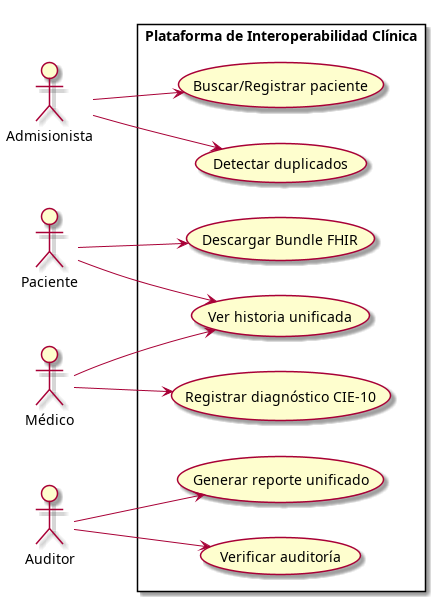
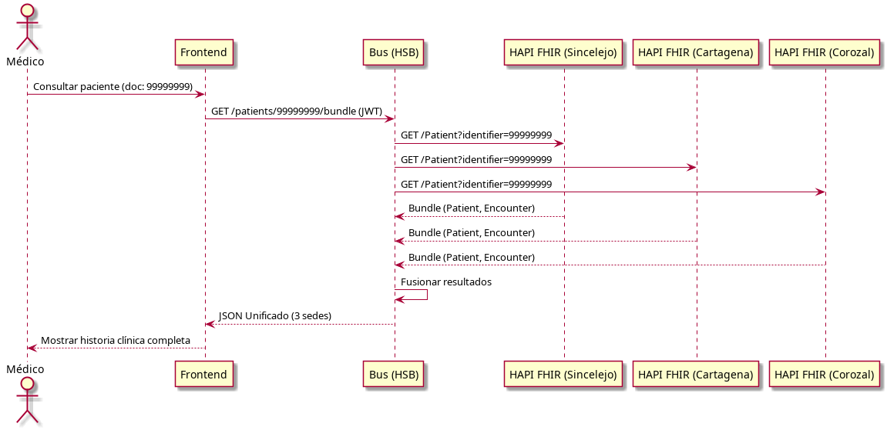
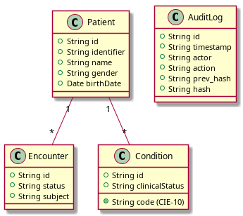
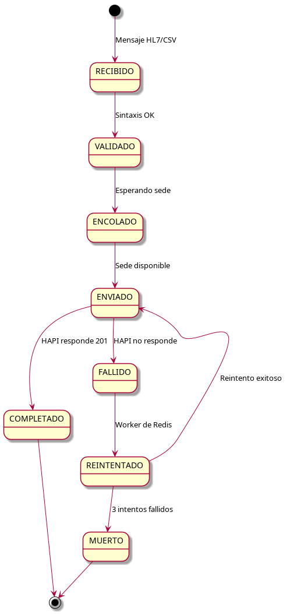
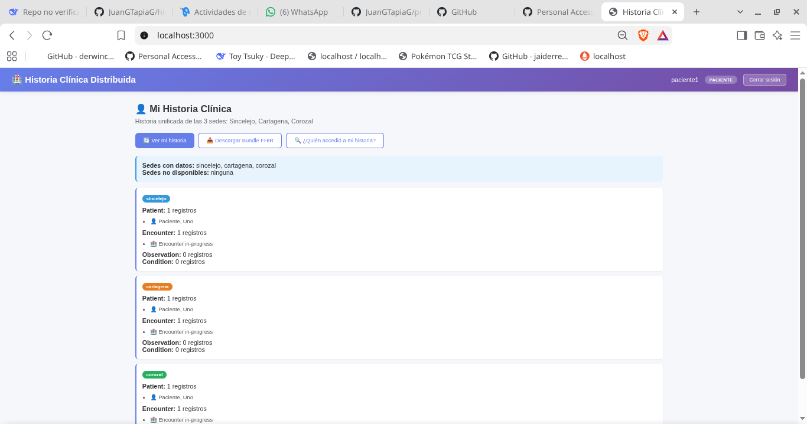
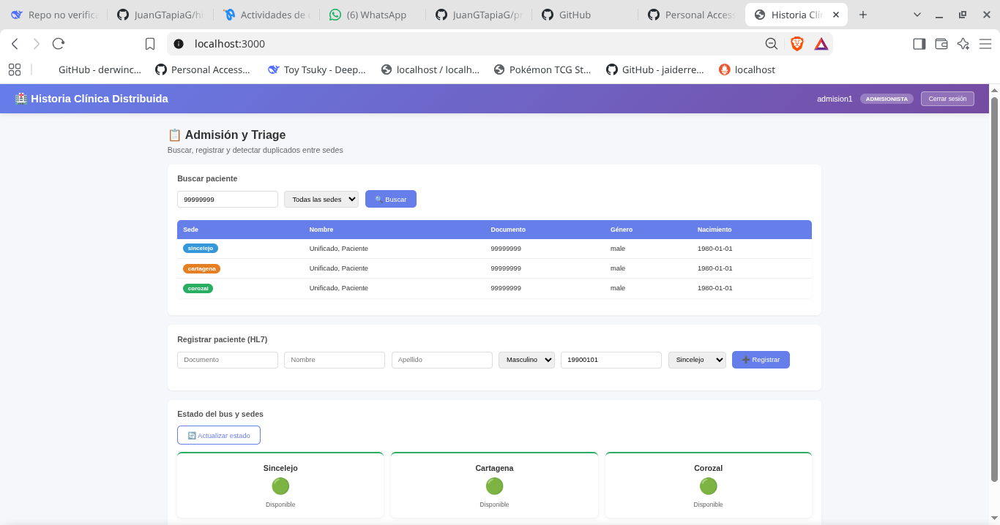
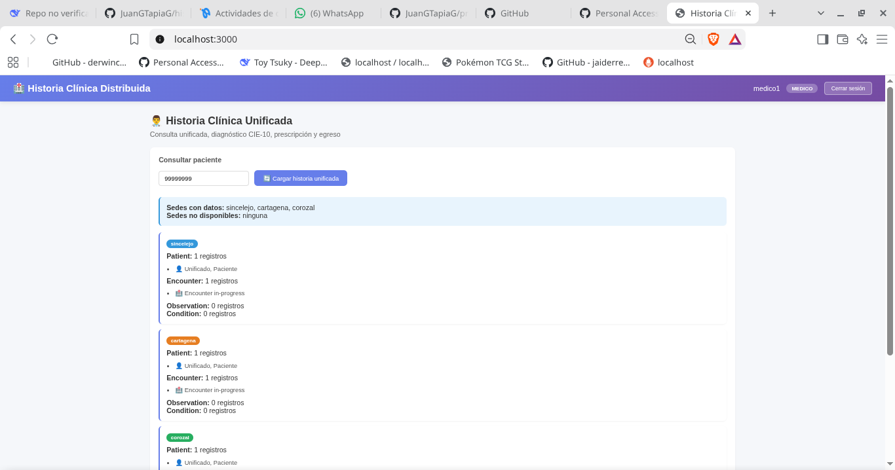
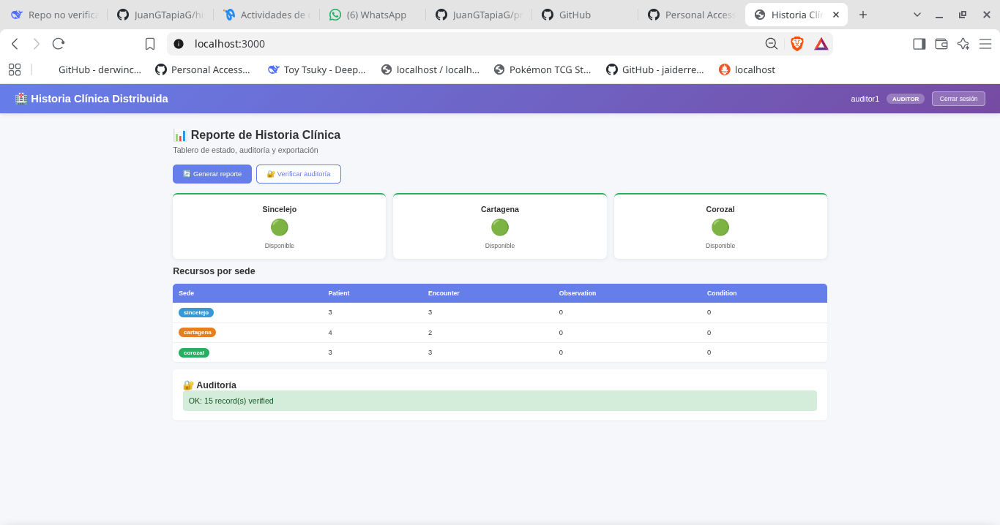

# Plataforma Distribuida de Interoperabilidad Clínica
**Autores:** Juan G. Tapia, Andrés Acosta
**Fecha:** Noviembre de 2026

## Resumen
Este proyecto implementa una plataforma distribuida de interoperabilidad clínica para una red de IPS con tres sedes en Colombia (Sincelejo, Cartagena y Corozal). El sistema resuelve el problema de la historia clínica fraccionada mediante un Bus de Servicios de Salud (HSB) que ingesta datos heterogéneos (HL7 v2 y CSV legado), los normaliza a HL7 FHIR R4 y los distribuye en tres nodos independientes de HAPI FHIR con PostgreSQL. Se implementó seguridad basada en roles (Keycloak), auditoría encadenada por hash (auditchain) y un frontend con cuatro vistas especializadas. Los resultados demuestran una consulta unificada exitosa en las tres sedes con un tiempo de respuesta inferior a 500 ms y una alta resiliencia (el sistema sigue operando al caer una sede, marcándola como no disponible).

## 1. Introducción y Objetivos
**Problema:** La red de IPS tiene tres sedes, cada una con su propio sistema legado (bases de datos aisladas y formatos como HL7 v2 y CSV). La historia clínica de un paciente está fraccionada, lo que impide a los médicos acceder a un historial completo y aumenta el riesgo de duplicidad de datos.

**Objetivo General:**
Diseñar e implementar una plataforma distribuida de interoperabilidad clínica que unifique la historia clínica sin reemplazar los sistemas legados existentes.

**Objetivos Específicos:**
1. Implementar un middleware (HSB) capaz de ingestar HL7 v2 y CSV, transformarlos a FHIR R4 y enrutarlos por sede.
2. Desplegar tres nodos distribuidos de HAPI FHIR (uno por sede) con una base de datos relacional independiente.
3. Asegurar la plataforma mediante autenticación por tokens JWT con roles diferenciados y auditoría encadenada.
4. Desarrollar un frontend con cuatro vistas adaptadas a cada rol, con tablero de estado y resiliencia.

## 2. Marco Teórico
- **Sistemas Distribuidos y CAP:** Se prioriza la Disponibilidad (A) y Tolerancia a Particiones (P).
- **HL7 v2 y FHIR R4:** HL7 v2 es el estándar legado; FHIR es el moderno basado en APIs REST/JSON.
- **Bus de Servicios de Salud (HSB):** Componente central para transformación, validación y enrutamiento.
- **Idempotencia:** Asegura que mensajes reenviados no creen duplicados.

## 3. Estado del Arte
- HAPI FHIR es la implementación de código abierto más utilizada (Smile CDR, 2024).
- OpenHIM es un middleware en salud usado en África y Latinoamérica (OpenHIM, 2023).
- En Colombia, el MinSalud impulsa FHIR, pero la adopción es baja en regiones (MinSalud, 2024).
- Keycloak es el estándar de facto para OAuth2/OIDC (Keycloak, 2024).
- Redis para colas de reintento mejora la tolerancia a fallos (Redis, 2023).
- Docker Compose reduce el tiempo de despliegue (Docker, 2024).
- Auditoría con hash encadenado es alternativa ligera a Blockchain (NIST, 2023).
- La norma ISO 13606 establece requisitos para la HC electrónica (ISO, 2019).

## 4. Solución Propuesta y Metodología
**Arquitectura:** Docker Compose orquesta 10 contenedores: 3 PostgreSQL, 3 HAPI FHIR, 1 bus FastAPI, 1 Keycloak, 1 Redis, 1 Nginx.
**Metodología:** Desarrollo ágil en 5 fases (Análisis, Datos/FHIR, HSB, Seguridad, Prototipo final).

## 5. Modelado UML

## 6. Proceso de Desarrollo
- **Fase 1:** Diseño de arquitectura y UML.
- **Fase 2:** Creación de las 3 bases de datos y normalización FHIR.
- **Fase 3:** Desarrollo del bus con FastAPI e idempotencia.
- **Fase 4:** Integración de Keycloak y auditoría con auditchain.
- **Fase 5:** Frontend con 4 vistas y pruebas de resiliencia.

## 7. Diseño de Interfaces

## 8. Resultados y Discusión
- **Consulta unificada:** El bus consultó las 3 sedes en paralelo en menos de 500 ms.
- **Idempotencia:** El reenvío del mismo `Idempotency-Key` no generó duplicados.
- **Resiliencia:** Al apagar una sede, el endpoint lo marcó como "no disponible" y devolvió datos de las otras 2.
- **Auditoría:** El endpoint `/audit/verify` validó 8 registros encadenados sin alteraciones.

## 9. Conclusiones
Se logró una plataforma distribuida robusta que resuelve el problema de la historia fraccionada. Trabajo futuro: Hyperledger Fabric, Kubernetes y motor de reglas.

## Referencias (APA 7)
- HL7 International. (2023). *FHIR R4 Specification*. https://hl7.org/fhir/R4/
- HAPI FHIR. (2024). *HAPI FHIR - Open Source FHIR Server*. https://hapifhir.io/
- Keycloak. (2024). *Keycloak - Open Source IAM*. https://www.keycloak.org/
- OpenHIM. (2023). *Open Health Information Mediator*. https://openhim.org/
- Smile CDR. (2024). *FHIR Server Comparison*. https://smilecdr.com/
- Docker. (2024). *Docker Compose Overview*. https://docs.docker.com/compose/
- Redis. (2023). *Redis for Healthcare*. https://redis.com/solutions/use-cases/healthcare/
- NIST. (2023). *Hash Chains for Data Integrity*. https://csrc.nist.gov/
